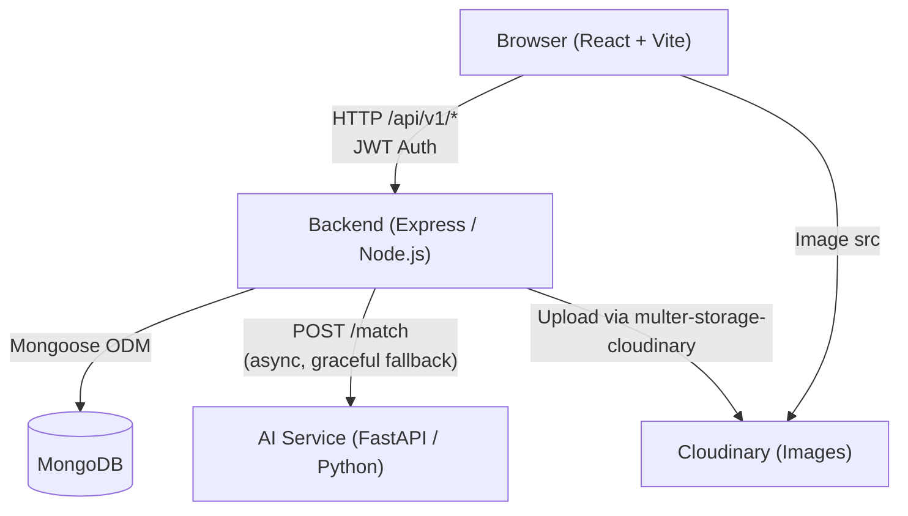

# FindIt — System Architecture

## Architecture Diagram



## Component Responsibilities

| Component | Responsibility |
|---|---|
| **React Frontend** | UI, routing, form validation (Zod), API calls via Axios, auth state (Context), notification polling |
| **Express Backend** | REST API, JWT auth, rate limiting, Zod validation, business logic, DB queries, async AI invocation |
| **MongoDB** | Persistent storage: users, items, claims, matches, notifications, abuse reports |
| **AI Service** | Stateless similarity computation: text (Sentence Transformers), image (CLIP optional), location, date |
| **Cloudinary** | Cloud image storage and transformation (optional; local disk fallback available) |

## Request Flow: Report Item

```
1. POST /api/v1/items (multipart/form-data)
2. Backend: validate (Zod) → upload image (Cloudinary or disk)
3. Backend: create Item in MongoDB
4. Backend: respond 201 to client
5. Backend (async, setImmediate): findMatchesForItem()
   └─ Query 50 opposite-type items of same category
   └─ For each: POST /match to AI service (with timeout)
      ├─ AI responds: save Match with scores
      └─ AI fails: compute fallbackMatch(), save with status=fallback
   └─ If score ≥ 0.5: create Notification for item owner
```

## Request Flow: Submit Claim

```
1. POST /api/v1/items/:id/claims
2. Backend: check item exists, status=open, not self-claim, no duplicate
3. Backend: create ClaimRequest (verificationAnswers stored encrypted-at-rest by MongoDB)
4. Backend: update item.status → 'claimed'
5. Backend: create Notification for item reporter
6. Respond 201 to claimant
7. Reporter reviews: PUT /api/v1/claims/:id/review
   ├─ approved: item.status → 'resolved', reject other pending claims, share contact
   └─ rejected: item.status → 'open' (if no other claims), notify claimant
```

## Security Model

| Concern | Mitigation |
|---|---|
| Password storage | bcrypt (12 rounds) |
| Auth tokens | JWT (7 day expiry), stored in localStorage |
| API security | Helmet headers, CORS allow-list, rate limiting |
| Input validation | Zod schemas on both frontend and backend |
| Authorization | Owner check + admin check on every write operation |
| Private data | Verification answers never returned to non-owners |
| Contact info | Email/phone only visible to authenticated users |
| Image upload | File type + size validated, stored via Cloudinary or controlled local path |
| Admin actions | Enforced by `adminOnly` middleware on all `/admin/*` routes |
| SSRF (AI service) | URL scheme validated before fetching images for CLIP |
